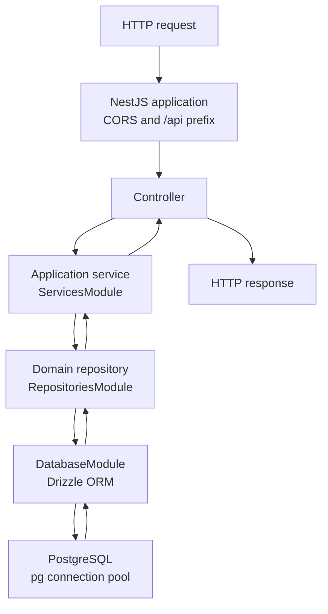

# PROJECT GUIDE

_Prepared by: GitHub Copilot (GPT-5.2-Codex)_

This guide is a handoff for developers who need to continue working on the Turva backend. It documents what is already implemented, where the data comes from, how the application is structured, and how clients are expected to interact with it based on current endpoints and data models.

## Table of Contents

- [1. Scope and Purpose](#1-scope-and-purpose)
- [2. What Exists Today](#2-what-exists-today)
- [3. Application Structure](#3-application-structure)
- [4. Startup and Runtime](#4-startup-and-runtime)
- [5. Data Sources and Models](#5-data-sources-and-models)
- [6. API Surface](#6-api-surface)
- [7. Authentication Flow](#7-authentication-flow)
- [8. Infrastructure in Repo](#8-infrastructure-in-repo)
- [9. Testing in Repo](#9-testing-in-repo)
- [10. Not Present in This Repo](#10-not-present-in-this-repo)
- [11. File Map (Key Files)](#11-file-map-key-files)

## 1. Scope and Purpose

- This is a backend repository for the TurvaOppi platform.
- Client applications are expected to consume the REST API endpoints defined here.
- The guide covers only current, verifiable code and configuration in this repository.

## 2. What Exists Today

**Primary backend responsibilities**

- Serve informational pages from `info`.
- Serve quiz content from `Quiz` and `World`.
- Track quiz completion and world completion per user.
- Provide world bonus calculations per user.
- Issue and verify physical reward codes.

**Technology stack**

- Node.js, TypeScript, NestJS (Express platform)
- PostgreSQL via Drizzle ORM and the `pg` connection pool
- JWT auth via `jsonwebtoken`
- OTP hashing via `bcryptjs`
- Email sending via `nodemailer` (Ethereal test SMTP)
- OpenAPI documentation via `@nestjs/swagger`

## 3. Application Structure

**Execution architecture**



Each layer delegates to the next: controllers handle HTTP concerns, services
coordinate application behavior, repositories contain persistence queries, and
the `DatabaseModule` provides the Drizzle connection. Results return through
the same layers to the HTTP response.

**Routing**

- Controllers are registered directly in [src/app.module.ts](src/app.module.ts).
- The global `/api` prefix is configured in [src/app.ts](src/app.ts).

**Data access**

- Controllers call application services; they do not inject the database or
  repositories.
- Services use domain repositories for persistence. Drizzle queries are
  contained in [src/database/repositories](src/database/repositories).
- [RepositoriesModule](src/database/repositories/repositories.module.ts)
  imports [DatabaseModule](src/database/database.module.ts); the
  [ServicesModule](src/services/services.module.ts) exports services to
  `AppModule` without exposing repositories to controllers.
- [src/config/db.ts](src/config/db.ts) provides the PostgreSQL connection pool
  used by Drizzle.

## 4. Startup and Runtime

**Entry point**

- [src/main.ts](src/main.ts) loads env vars, configures the NestJS application,
  and starts the server on port `3000`. Database initialization and pending
  migrations are handled by `DatabaseModule`.
- Nest CLI configuration is in [nest-cli.json](nest-cli.json); run `npm run start:dev` for watch mode and `npm run build` to compile to `dist/`.

**Swagger**

- If `ENABLE_SWAGGER=true`, Swagger UI is enabled at `/docs` and the OpenAPI JSON is available at `/docs.json`. The document is generated from Nest route and Swagger decorators in [src/app.ts](src/app.ts) and the route controllers.

## 5. Data Sources and Models

**Schema source**

- Table definitions are code-first in [src/database/schema.ts](src/database/schema.ts).
- Generate and review schema migrations with `npm run db:generate`; apply them
  with `npm run db:migrate`. [DatabaseModule](src/database/database.module.ts)
  also applies pending migrations when the app starts.
- [sql/init.sql](sql/init.sql) is retained for local bootstrap and seed data;
  future schema changes belong in the Drizzle schema and generated migrations.

**Key tables used by the API**

- `info`
- `Organization`
- `TurvaUser`
- `World`
- `Quiz`
- `User_Completed_Quiz`
- `User_Completed_World`
- `CrisisTeam`
- `Physical_Reward`
- `email_otps`

**Relationships (textual)**

```
Organization (1) -> TurvaUser (N)
Organization (1) -> World (N)
World (1) -> Quiz (N)
TurvaUser (1) -> User_Completed_Quiz (N) -> Quiz (1)
TurvaUser (1) -> User_Completed_World (N) -> World (1)
TurvaUser (1) -> Physical_Reward (N)
Organization (1) -> CrisisTeam (N)
```

**Schema name alignment**

- `World` uses `world_name_fi` and `world_name_en` in the schema.
- `Quiz` uses `quiz_name_fi` and `quiz_name_en` in the schema.
- The current quiz routes and tests use `quiz_name` and some tests insert `world_name`.

## 6. API Surface

Base path: `/api`

**Info management**

- `GET /info`
- `GET /info/:id`
- `POST /info`
- `PUT /info/:id`
- `DELETE /info/:id`

**Quiz management**

- `GET /quiz`
- `GET /quiz/:id`
- `GET /quiz/world/:world_id/quizzes`
- `POST /quiz`
- `PUT /quiz/:id`
- `DELETE /quiz/:id`

**World and bonuses**

- `GET /world`
- `GET /world-bonus/user/:user_id`

**Crisis team management**

- `GET /crisis-team`
- `GET /crisis-team/:id`
- `POST /crisis-team`
- `PUT /crisis-team/:id`
- `DELETE /crisis-team/:id`

**User-facing data**

- `GET /user/profile` (JWT required)
- `GET /quiz-result/user/:user_id/stats`
- `GET /quiz-result/user/:user_id/history`

**Physical reward verification (QR scan use case)**

- `GET /physical-reward/verify/:code` returns HTML

Controller implementations are in [src/controllers](src/controllers).

## 7. Authentication Flow

**OTP login flow**

1. `POST /api/auth/login` validates user and sends OTP email.
2. OTP is stored in `email_otps` as a bcrypt hash.
3. `POST /api/auth/verify` validates OTP and issues JWT.

**JWT usage**

- JWT is generated in [src/utils/tokenGenerator.ts](src/utils/tokenGenerator.ts).
- JWT is verified in [src/utils/verification.ts](src/utils/verification.ts).
- Auth checks are performed inside handlers, not as Express middleware.

## 8. Infrastructure in Repo

**Docker**

- [Dockerfile](Dockerfile) runs the dev server in a container.

**docker-compose**

- [docker-compose.yml](docker-compose.yml) runs app + Postgres; the SQL
  bootstrap provides local seed data, and the app applies Drizzle migrations.

**CI**

- Lint-only GitHub Actions workflow in [.github/workflows/ci_pipeline.yaml](.github/workflows/ci_pipeline.yaml).

## 9. Testing in Repo

**Frameworks**

- Jest and Supertest.

**Tests present**

- Info API tests in [tests/infoapi.test.ts](tests/infoapi.test.ts).
- Auth API tests in [tests/loginapi.test.ts](tests/loginapi.test.ts).
- Quiz API tests in [tests/quizapi.test.ts](tests/quizapi.test.ts).

## 10. Not Present in This Repo

- No feature-specific NestJS module per domain; controllers are registered in
  `AppModule`, with application services and repositories grouped in their
  respective modules.
- No explicit role-based access control or privileged-route guards.
- No background workers, queues, or scheduled jobs.
- No monitoring or tracing integration.

## 11. File Map (Key Files)

- Entry point: [src/main.ts](src/main.ts)
- App setup and entry point: [src/main.ts](src/main.ts)
- Status controller: [src/controllers/status.controller.ts](src/controllers/status.controller.ts)
- Auth controller: [src/controllers/auth.controller.ts](src/controllers/auth.controller.ts)
- Info controller: [src/controllers/info.controller.ts](src/controllers/info.controller.ts)
- Quiz controller: [src/controllers/quiz.controller.ts](src/controllers/quiz.controller.ts)
- Quiz result controller: [src/controllers/quiz-result.controller.ts](src/controllers/quiz-result.controller.ts)
- World controller: [src/controllers/world.controller.ts](src/controllers/world.controller.ts)
- World bonus controller: [src/controllers/world-bonus.controller.ts](src/controllers/world-bonus.controller.ts)
- Crisis team controller: [src/controllers/crisis-team.controller.ts](src/controllers/crisis-team.controller.ts)
- Physical reward controller: [src/controllers/physical-reward.controller.ts](src/controllers/physical-reward.controller.ts)
- Services module: [src/services/services.module.ts](src/services/services.module.ts)
- Repositories module: [src/database/repositories/repositories.module.ts](src/database/repositories/repositories.module.ts)
- Database module: [src/database/database.module.ts](src/database/database.module.ts)
- Database repositories: [src/database/repositories](src/database/repositories)
- DB config: [src/config/db.ts](src/config/db.ts)
- CORS config: [src/config/cors.ts](src/config/cors.ts)
- Auth helpers: [src/utils/verification.ts](src/utils/verification.ts)
- JWT helper: [src/utils/tokenGenerator.ts](src/utils/tokenGenerator.ts)
- Email helper: [src/utils/emailer.ts](src/utils/emailer.ts)
- Swagger setup: [src/app.ts](src/app.ts)
