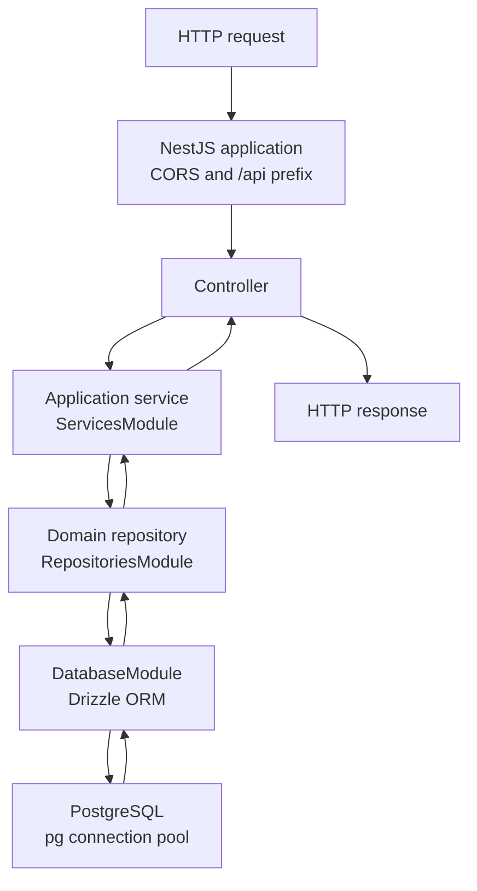

# turva-back

Backend API server for the TurvaOppi

## Documentation

- Project guide: [ProjectGuide.md](ProjectGuide.md)

## Project Setup

### Prerequisites

- [Node.js](https://nodejs.org/) v20 or higher
- npm
- [Docker](https://docs.docker.com/)

### Installation with Docker

1. Clone the repository

   ```bash
   git clone https://github.com/haagahelia/turva-back.git
   cd turva-back
   ```

2. Set environmental variables

   ```bash
   cp .env.example .env
   ```

3. Build and run the project

   ```bash
   docker compose up
   ```

### Code-first schema and migrations

The Drizzle schema in [src/database/schema.ts](src/database/schema.ts) is the
source for schema changes. To make a change, edit the schema and generate a
versioned migration:

```bash
npm run db:generate -- --name add-a-description
```

Review and commit the generated files in `drizzle/` with the schema change.
`DatabaseModule` applies pending migrations at application startup; run
`npm run db:migrate` to apply them manually. `drizzle.config.ts` reads the
database connection settings from `.env`.

The baseline migration is safe to apply to databases already initialized from
the legacy SQL bootstrap. `sql/init.sql` remains the local/test bootstrap,
including its original table DDL and sample data, for compatibility; make
future schema changes in the Drizzle schema and migrations. The older
`sql/migrations/001_add_user_role.sql` is retained for deployments that have
not yet adopted the Drizzle migration baseline.

To make a user admin, the user must have registered first. Open a `psql`
session on the target database:

```bash
# Local Docker
docker compose exec -it postgres sh -c 'psql -U "$POSTGRES_USER" -d "$POSTGRES_DB"'

# Rahti test database
oc exec -it deployment/turva-test-db -- sh -c 'psql -U "$POSTGRESQL_USER" -d "$POSTGRESQL_DATABASE"'
```

Then run this SQL at the `psql` prompt:

```sql
UPDATE TurvaUser
SET role = 'admin'
WHERE email_address = 'admin@example.com'
  AND deleted_at IS NULL
RETURNING user_id, email_address, role;
```

Replace the example address with the intended account and check that one row is
returned.

### Running the tests

The tests are integration tests: they create, update and delete rows in a real
PostgreSQL database. **Always use a separate local test database, never the
Rahti one.**

1. Start a throwaway database seeded with `sql/init.sql`:

   ```bash
   docker run -d --name turva-back-testdb -p 5432:5432 \
     -e POSTGRES_USER=turva -e POSTGRES_PASSWORD=test -e POSTGRES_DB=turva_test \
     -v "$(pwd)/sql/init.sql:/docker-entrypoint-initdb.d/init.sql:ro" \
     postgres:16-alpine
   ```

   The app always connects on port 5432, so stop any other local PostgreSQL
   (e.g. `docker compose down`) first.

2. Create `.env.test` (it is git-ignored, like `.env`):

   ```bash
   cp .env.example .env.test
   ```

   and set `POSTGRES_USER=turva`, `POSTGRES_PASSWORD=test`,
   `POSTGRES_DB=turva_test`, `POSTGRES_HOST=127.0.0.1`, any `JWT_SECRET`, and
   `TEST_DOMAIN=turva.back.fi`.

3. Run the tests:

   ```bash
   npm test
   ```

Remove the database afterwards with `docker rm -f turva-back-testdb`.

### Database access

The request execution path follows the Repository pattern:



Controllers handle HTTP concerns and call services; services coordinate
application behavior through domain repositories. Repositories contain the
Drizzle queries and are provided to services by
[RepositoriesModule](src/database/repositories/repositories.module.ts).
[ServicesModule](src/services/services.module.ts) exports application services
to `AppModule` without exposing repositories to controllers.

Table definitions live in [src/database/schema.ts](src/database/schema.ts),
and [DatabaseModule](src/database/database.module.ts) provides the Drizzle
connection. Schema changes are applied with generated Drizzle migrations
instead of automatic schema synchronization.

### Available Scripts

- `npm run dev` or `npm run start:dev` - Run the NestJS CLI in watch mode
- `npm run build` - Build the application with the NestJS CLI to `dist/`
- `npm run start` - Build and start the application
- `npm run start:prod` - Run the compiled application
- `npm run db:generate -- --name <description>` - Generate a migration from schema changes
- `npm run db:migrate` - Apply pending migrations
- `npm test` - Run Jest tests
- `npm run lint` - Run ESLint

The Husky pre-commit hook formats staged JavaScript, TypeScript, JSON, Markdown, and YAML files with Prettier.

### Tech Stack

Developed with NestJS, TypeScript, and Node.js. The API is served under `/api`.
