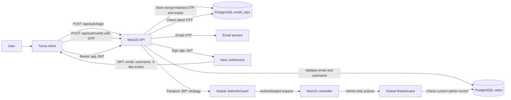
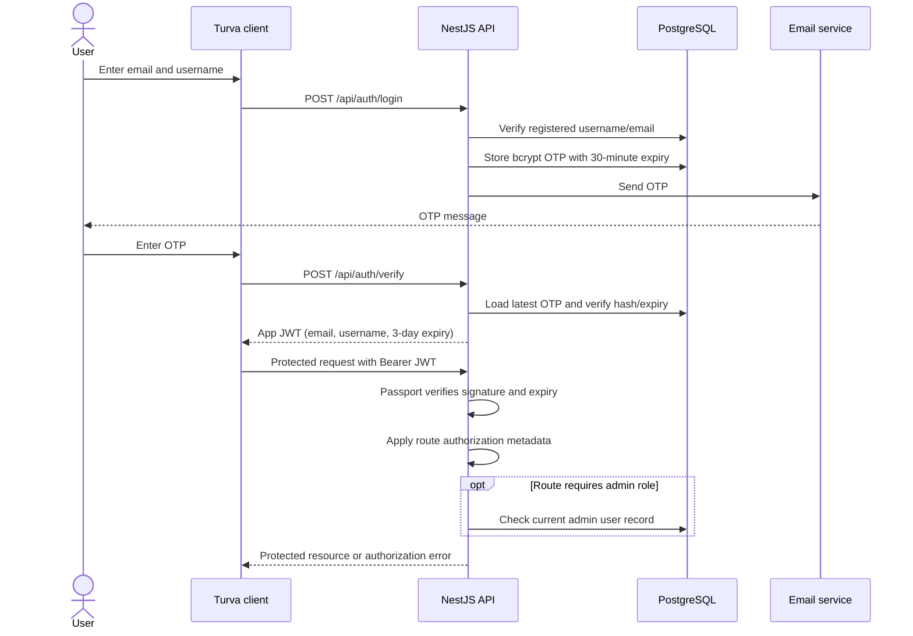
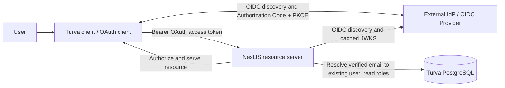
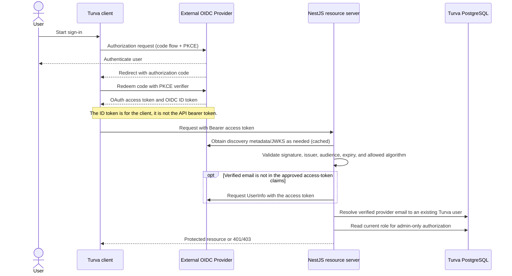

# Authentication and Authorization Architecture

This document separates the backend's **implemented authentication design**
from a **proposed external identity-provider design**. The proposed design is
not implemented and no identity provider has been selected.

## 1. Implemented: local OTP login and JWT-protected API

The backend currently handles login itself. It validates local user credentials,
sends and verifies a one-time email code, and issues its own three-day JWT. The
same backend then acts as a resource server for API routes by validating that
JWT.

### Login and request sequence

### Current responsibilities and access policy

| Component                                                                | Implemented responsibility                                                                                 |
| ------------------------------------------------------------------------ | ---------------------------------------------------------------------------------------------------------- |
| [`AuthController`](../src/controllers/auth.controller.ts)                | Public registration and email-OTP login/verification endpoints; issues the app JWT after OTP verification. |
| [`InfrastructureModule`](../src/infrastructure/infrastructure.module.ts) | Reads and validates `JWT_SECRET` through `ConfigModule`, then exposes it as an injectable value.           |
| [`AuthModule`](../src/auth/auth.module.ts)                               | Configures Nest `JwtService`, Passport, and the global JWT and role guards.                                |
| [`JwtStrategy`](../src/auth/jwt.strategy.ts)                             | Extracts a bearer token, validates it with the shared secret, and rejects expired tokens.                  |
| [`RolesGuard`](../src/auth/guards/roles.guard.ts)                        | Checks `@Roles("admin")` metadata and consults the current database admin record for admin-only routes.    |
| [`VerificationService`](../src/services/verification.service.ts)         | Verifies login credentials and OTPs, and performs the database-backed admin check.                         |

Authentication is opt-out: routes require a valid bearer JWT unless marked
`@Public()`. The public routes are the status root and ping, all `/auth` routes,
and `GET /physical-reward/verify/:code`. All other routes require
authentication. Info, quiz, world, and crisis-team management mutations require
the admin role; other protected routes are available to authenticated users.

The backend is therefore already a resource server for its own JWTs, but it
also performs local authentication and issues those tokens. It is not currently
an OAuth 2.0 authorization server or an OpenID Connect provider. The repository
contains no OIDC discovery, external issuer, JWKS validation, or OAuth client
flow.

## 2. Proposed: separate OIDC identity provider and resource server

In the target design, an independent identity provider (IdP) owns user
authentication and token issuance. A Turva client uses OpenID Connect over
OAuth 2.0 Authorization Code with PKCE. The backend accepts OAuth **access
tokens** as a resource server; it does not host the browser login redirect or
issue a replacement app JWT.

### Proposed sign-in and API request sequence

### Proposed trust and authorization rules

1. The client obtains tokens from the external IdP using Authorization Code
   with PKCE. The client configuration, redirect URI, and PKCE verifier belong
   to the client/IdP flow, not to the resource API.
2. The API accepts only access tokens intended for its configured audience and
   issuer. For JWT access tokens it validates the signature against the issuer's
   published keys, and checks issuer, audience, expiry, and an explicit
   algorithm allowlist. It must not accept an ID token in place of an access
   token.
3. The API requires a provider-asserted verified email and maps it to an
   existing Turva user. The provider must supply this through an agreed,
   trusted access-token claim or the API must obtain it from UserInfo; the API
   must not trust an email supplied only by the client. It does not
   automatically create accounts. The local database remains authoritative for
   Turva roles and admin authorization.
4. The API returns `401` for missing or invalid access tokens and `403` when
   the authenticated user lacks the required local authorization.
5. If the selected provider issues opaque access tokens instead of JWTs, the
   API must validate them through that provider's token-introspection endpoint;
   JWKS signature verification applies to signed JWT access tokens.
6. On cutover, the local OTP endpoints and app-owned JWT issuance are retired
   or disabled. Registration/provisioning must ensure both an IdP identity and
   a corresponding existing Turva user record are available.

The exact issuer, API audience, token format, claim mapping, key-refresh
behavior, client registrations, and provisioning procedure must be agreed with
the selected provider before implementation.

## 3. Identity-provider options

These are architectural options, not decisions or dependencies in the current
code. The resource-server validation and local-role design can remain
provider-neutral.

| Option                                      | Benefits                                  | Tradeoffs and responsibilities                                                                                                              |
| ------------------------------------------- | ----------------------------------------- | ------------------------------------------------------------------------------------------------------------------------------------------- |
| **Self-hosted Keycloak**                    | Mature OIDC, control, data locality.      | Operate upgrades, security patches, availability, backups, TLS, monitoring, and key rotation.                                               |
| **Managed OIDC service (provider-neutral)** | Lower infrastructure burden; admin tools. | Compare recurring cost, vendor lock-in, claim/policy limits, data location, and migration path; provider not yet selected.                  |
| **Auth0**                                   | Concrete managed service with tooling.    | Evaluate pricing/usage limits, data residency, tenant and claim customization, and migration effort.                                        |
| **Custom OIDC provider**                    | Maximum control and tailored integration. | Own protocol/security, credentials, sessions, consent, signing/key rotation, discovery/JWKS, abuse controls, and maintenance; highest risk. |

No option is selected. A practical evaluation should first determine whether
self-hosting is a requirement; if not, compare the operational and policy fit
of managed services, including Auth0, before considering a custom provider.

## 4. Migration boundary

This proposal changes who authenticates users and issues tokens, not the
backend's domain authorization policy. The external IdP is the authentication
authority; the Turva API remains responsible for validating access tokens,
mapping identities to local accounts, enforcing local roles, and serving
resources. Implementing this target would require a separately planned runtime
change; this document does not modify the current OTP/JWT implementation.
